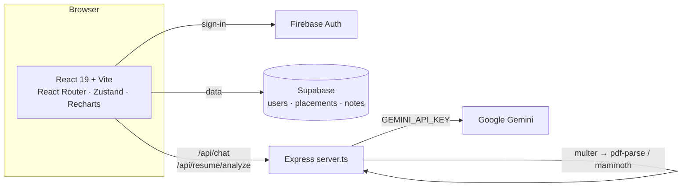

<h1 align="center">⚙️ EngineerOS AI</h1>

<p align="center"><b>One workspace for an engineering student's placement journey: AI mentor, résumé analysis, roadmap, placement tracker, coding log and notes.</b></p>

<p align="center">
  
  
  
  
  
  
  
</p>

## Problem

Students preparing for placements juggle a résumé doc, a spreadsheet of applications, a LeetCode tab, scattered notes and generic career advice. EngineerOS puts those in one signed-in dashboard and adds an AI mentor that can see the context.

## Features

| Page | What it does |
|---|---|
| **Dashboard** | Overview of progress across the other modules |
| **AI Mentor** | Chat backed by Gemini through the server (`POST /api/chat`); the key never reaches the browser |
| **Résumé** | Upload PDF or DOCX → text extracted server-side (`pdf-parse`, `mammoth`) → Gemini feedback (`POST /api/resume/analyze`) |
| **Roadmap** | Career roadmap with AI recommendations |
| **Placement** | Track companies, rounds and status (`placements` table) |
| **Coding** | Log practice problems |
| **Notes** | Personal study notes (`notes` table) |
| **Auth** | Email/password and Google sign-in through Firebase Auth; Profile and Settings pages |

## Architecture



## Project structure

```text
server.ts                 # Express: Gemini chat + résumé analysis, serves the SPA in production
src/
  pages/                  # Dashboard, Mentor, Resume, Roadmap, Placement, Coding, Notes, Profile, Settings, Login, Signup
  components/             # common/, mentor/, resume/
  services/               # firebase/, gemini/, resume/, supabase/
  store/ hooks/ context/ routes/
supabase/schema.sql       # users, placements, notes tables
```

## Run locally

```bash
git clone https://github.com/nvaltryek-001/EngineerOS-AI && cd EngineerOS-AI
npm install
cp .env.example .env      # set GEMINI_API_KEY; Firebase/Supabase values optional (see below)
npm run dev               # Express + Vite on one port
```

| Variable | Needed for |
|---|---|
| `GEMINI_API_KEY` | AI Mentor and résumé analysis (server-side only) |
| `VITE_FIREBASE_*` | Your own Firebase project. If unset, the app falls back to the project's public web config. |
| `SUPABASE_URL`, `SUPABASE_ANON_KEY` | Persisting placements and notes; apply `supabase/schema.sql` first |

Production: `npm run build && npm start` (bundles `server.ts` to `dist/server.cjs`).

## Quality checks

- `npm run lint`: TypeScript type-check (`tsc --noEmit`)
- CI (`.github/workflows/ci.yml`) runs type-check and build on every push and PR.

## Known limitations

- No automated tests yet; CI covers type-check and build only.
- AI answers depend on Gemini availability and quota; without `GEMINI_API_KEY` the mentor replies with a clearly labelled mock response.

## Roadmap

- Unit tests for the résumé extraction endpoint.
- Screenshots and demo GIF in `docs/`.
