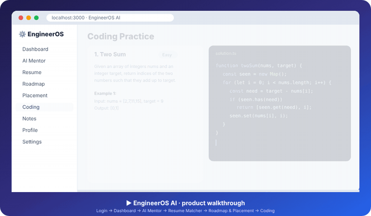
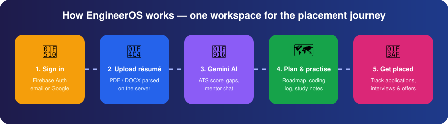
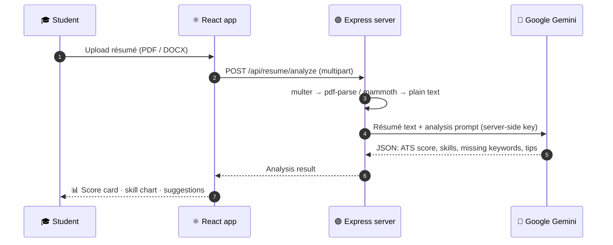
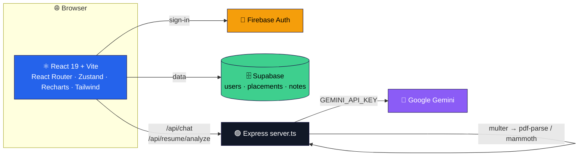

<div align="center">


<br/>


**[🎬 Demo](#-demo-video) · [💡 Problem](#-the-problem) · [✨ Features](#-features) · [⚙️ How it works](#%EF%B8%8F-how-it-works) · [🏗 Architecture](#-architecture) · [💻 Run](#-run-locally) · [📂 Structure](#-project-structure)**

</div>


## 🎬 Demo Video

<div align="center">



[](docs/assets/engineeros-demo.mp4)


<sub>🎨 Animated walkthrough of the app's pages, built from the real page layouts and labels. The numbers shown are sample data.</sub>

</div>

### 🧭 What the demo shows

| ⏱️ Time | 🖥️ Screen | 👀 What you see |
|:-:|---|---|
| `0:00` | 🔐 **Login** | Email + password or **Continue with Google** (Firebase Auth) |
| `0:03` | 📊 **Dashboard** | Problems solved, interviews scheduled, roadmap progress, notes created, recent applications |
| `0:06` | 🤖 **AI Mentor** | Student asks a question → **Gemini** replies with a study plan + a suggestion card |
| `0:09` | 📄 **Resume Matcher** | Upload PDF/DOCX → **ATS score**, skill bars, missing keywords, improvement tips |
| `0:12` | 🎯 **Placement + Roadmap** | Applied / interviews / offers, Full-Stack roadmap milestones, AI recommendation |
| `0:15` | 💻 **Coding** | Practise a problem in `solution.ts` and log it to your progress |


## 💡 The Problem

> Students preparing for placements juggle a **résumé doc**, a **spreadsheet of applications**, a **LeetCode tab**, **scattered notes** and **generic career advice**.
>
> **EngineerOS AI** brings all of that into **one signed-in dashboard** and adds an **AI mentor** that understands the student's context.

<table>
<tr>
<td align="center" width="20%">🤖<br/><b>AI Mentor</b><br/><sub>Gemini chat</sub></td>
<td align="center" width="20%">📄<br/><b>Résumé AI</b><br/><sub>ATS score + gaps</sub></td>
<td align="center" width="20%">🗺️<br/><b>Roadmap</b><br/><sub>Personalised path</sub></td>
<td align="center" width="20%">🎯<br/><b>Placements</b><br/><sub>Apply → Offer</sub></td>
<td align="center" width="20%">💻<br/><b>Coding + Notes</b><br/><sub>Daily practice</sub></td>
</tr>
</table>


## ✨ Features

| | Page | What it does |
|:-:|---|---|
| 📊 | **Dashboard** | Overview of progress across every module: problems solved, interviews, roadmap progress, notes, recent applications |
| 🤖 | **AI Mentor** | Chat backed by **Google Gemini** through the server (`POST /api/chat`). The API key **never reaches the browser** |
| 📄 | **Résumé Matcher** | Upload **PDF or DOCX** → text extracted server-side (`pdf-parse`, `mammoth`) → Gemini returns an **ATS score**, technical skills, soft skills, **missing keywords** and **improvement suggestions** (`POST /api/resume/analyze`) |
| 🗺️ | **Career Roadmap** | Step-by-step learning path with **AI recommendations** |
| 🎯 | **Placement Tracker** | Track companies, rounds and status: total applied, active interviews, offers (`placements` table) |
| 💻 | **Coding** | Problem statement + code editor view to log practice problems |
| 📝 | **Notes** | Personal study notes (`notes` table) |
| 🔐 | **Auth** | Email/password and **Google sign-in** through Firebase Auth, protected routes, Profile and Settings pages |


## ⚙️ How it works

<p align="center">

</p>

### 📄 Résumé analysis flow




## 🏗 Architecture



| Layer | Tech |
|---|---|
| 🎨 Frontend | React 19, TypeScript, Vite, Tailwind CSS 4, React Router 7, Zustand, Recharts, Motion, Lucide icons |
| 🟢 Backend | Express (`server.ts`), Multer uploads, `pdf-parse`, `mammoth` |
| 🤖 AI | Google Gemini via `@google/genai` (server-side only) |
| 🔐 Auth | Firebase Authentication (email/password + Google) |
| 🗄️ Database | Supabase (Postgres) — schema in `supabase/schema.sql` |


## 💻 Run locally

<details open>
<summary><b>✅ Requirements</b></summary>
<br/>

| Tool | Version |
|---|---|
| 🟢 Node.js | 20+ |
| 🔑 Gemini API key | free from Google AI Studio |
| 🗄️ Supabase project | optional, for saving placements & notes |

</details>

```bash
git clone https://github.com/nvaltryek-001/EngineerOS-AI && cd EngineerOS-AI
npm install
cp .env.example .env      # set GEMINI_API_KEY; Firebase/Supabase values optional (see below)
npm run dev               # Express + Vite on one port
```

| Variable | Needed for |
|---|---|
| `GEMINI_API_KEY` | 🤖 AI Mentor and résumé analysis (server-side only) |
| `VITE_FIREBASE_*` | 🔐 Your own Firebase project. If unset, the app falls back to the project's public web config |
| `SUPABASE_URL`, `SUPABASE_ANON_KEY` | 🗄️ Persisting placements and notes; apply `supabase/schema.sql` first |

🚀 **Production:** `npm run build && npm start` (bundles `server.ts` to `dist/server.cjs`).


## 📂 Project structure

```text
📦 EngineerOS-AI
 ┣ 🟢 server.ts              Express: Gemini chat + résumé analysis, serves the SPA in production
 ┣ 📁 src/
 ┃ ┣ 📄 pages/               Dashboard · Mentor · Resume · Roadmap · Placement · Coding · Notes · Profile · Settings · Login · Signup
 ┃ ┣ 🧩 components/          common/ · mentor/ · resume/
 ┃ ┣ 🔌 services/            firebase/ · gemini/ · resume/ · supabase/
 ┃ ┗ 🗃️ store/ hooks/ context/ routes/
 ┣ 🗄️ supabase/schema.sql    users · placements · notes tables
 ┗ 🎬 docs/assets/           demo video, GIF and diagrams used in this README
```


## 🧪 Quality checks

- ✅ `npm run lint` — TypeScript type-check (`tsc --noEmit`)
- 🔁 Production build: `npm run build`

<details>
<summary><b>⚠️ Known limitations</b></summary>
<br/>

- 🧪 No automated tests yet.
- 🤖 AI answers depend on Gemini availability and quota. Without `GEMINI_API_KEY` the mentor replies with a clearly labelled mock response.

</details>

<details>
<summary><b>🛣️ Roadmap</b></summary>
<br/>

- Unit tests for the résumé extraction endpoint.
- Screen recording of the deployed app alongside the animated walkthrough.

</details>

<div align="center">

<br/>

⭐ **If you like this project, give it a star!** ⭐


</div>
